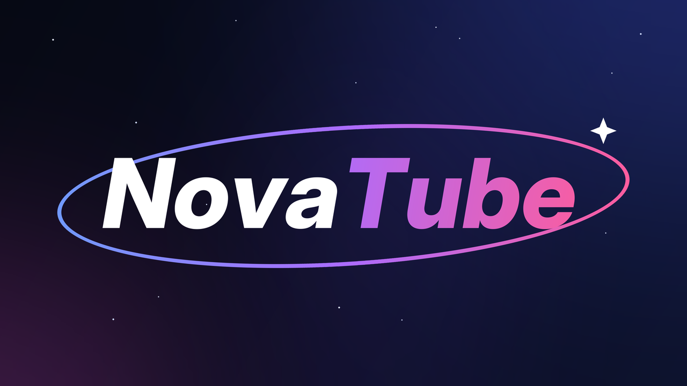

<p align="center"></p>

# NovaTube

**YouTube sans publicité, aux couleurs de NovaTV**, pour **Fire TV, Android TV et smartphone Android**.
Une appli de la famille [NovaTV](https://github.com/RappaceFer/NovaTV), par Rappace.

## Télécharger

Dans **Downloader** sur la Fire TV (ou dans le navigateur du téléphone) :

```
https://github.com/RappaceFer/NovaTube/raw/main/release/NovaTube.apk
```

## Ce que fait NovaTube

- **Aucune publicité**, et saut automatique des passages sponsorisés (SponsorBlock).
- **Votre compte YouTube** : Réglages → Comptes → Ajouter un compte, puis le code à valider sur `yt.be/activate`
  (le mot de passe ne passe jamais par l'appli).
- **Thème NovaTube** : fond « ciel de nuit » bleu nuit de NovaTV, accents violets, barre de lecture rose,
  logo et icône dans le style NovaTV.
- **Sûre** : compilée ici depuis le code source, sans les APK ni les bibliothèques précompilées du développeur
  d'origine (aucune trace de `libalphasdk.so`, le logiciel espion de l'incident SmartTube de novembre 2025),
  **sans mise à jour automatique** et sans téléchargement d'APK externe. Signée avec la clé Rappace
  (empreinte SHA-256 `E4:AC:EA:A5:FC:E4:A7:98:5E:DA:C1:38:02:5A:82:B5:84:DB:E7:5A:3C:D5:97:D6:50:B2:58:61:F1:BC:C9:33`,
  la même que NovaTV).

## Comment c'est fait

NovaTube = le moteur de **[SmartTube](https://github.com/yuliskov/SmartTube)** (Yuriy Liskov, licence MIT),
variante F-Droid, + une surcouche NovaTube :

| Dossier | Rôle |
|---|---|
| `novatube/res/` | couleurs, styles, fond, icônes, bannière TV, logo |
| `novatube/patches/` | À propos « NovaTube — édition Rappace », thème NovaTube par défaut, aucun APK externe |
| `novatube/outils/art.py` | dessine l'icône, la bannière et le logo (Python + Pillow, police Inter Display) |
| `novatube/construire.ps1` | télécharge SmartTube, applique la surcouche, compile, signe et vérifie l'APK |

Mettre à jour le moteur quand YouTube change quelque chose (Windows, JDK 17 et SDK Android installés,
clé de signature dans `cle-de-signature\` à côté du dossier `novatube\`) :

```
powershell -ExecutionPolicy Bypass -File novatube\construire.ps1 -MettreAJour
```

## Licence

Le moteur SmartTube est © 2020-présent yuliskov, sous licence MIT (voir [LICENSE-SmartTube](LICENSE-SmartTube)).
La surcouche NovaTube est © 2026 Rappace, sous licence MIT (voir [LICENSE](LICENSE)).
NovaTube n'est affiliée ni à YouTube ni à Google.
